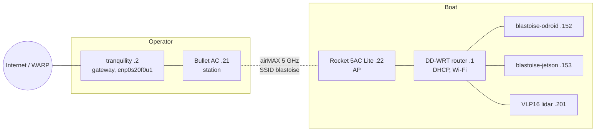

# astro_dock

### Overview

This repository provides a project-agnostic ROS container workspace and host tooling for robotics development, with sensor drivers and integration for the Unity simulator in [`crane_sim`](https://github.com/1unarzDev/crane_sim). Startup uses prebuilt images from [`lunarzdev/astro`](https://hub.docker.com/r/lunarzdev/astro); application code lives in the mounted workspace and can be rebuilt independently.

The stack uses ROS 2 Jazzy. Linux, NVIDIA Jetson, Raspberry Pi, Windows, and macOS have Compose adapters; robotics hardware runs on native Linux, while desktop hosts also support development and simulation connections.

### Architecture

The `dev` service runs as `roboboat` in `/home/roboboat/roboboat_ws`, with the repository mounted as its workspace. Development containers are privileged; native Linux adapters expose `/dev` for hardware access.

| Component | Responsibility |
| --- | --- |
| [`.devcontainer/`](.devcontainer/) | Runtime images, Compose adapters, shell setup, deployment, and validation |
| [`ROS-TCP-Endpoint`](https://github.com/MHSeals/ROS-TCP-Endpoint) | ROS connection to the Unity simulator; included as a submodule |
| [`crane_sim`](https://github.com/1unarzDev/crane_sim) | Unity physics and simulated sensors; runs separately |
| `sitl` service | Optional ArduPilot simulated flight controller; AMD64 image |

Runtime images separate the host capabilities:

| Image tag | Platform / stack | Purpose |
| --- | --- | --- |
| `core` | AMD64 / ARM64, Ubuntu 24.04, Jazzy | General ROS development and MAVROS |
| `cuda` | AMD64, Ubuntu 24.04, Jazzy, CUDA / ZED | NVIDIA desktop development and cameras |
| `jetson-jp6-jazzy` | ARM64, JetPack 6 / L4T R36, Ubuntu 22.04, Jazzy, ZED 5.4 | Orin camera / GPU host |
| `sitl` | AMD64, ArduPilot | Simulated FCU |

Jetson images contain camera drivers; MAVROS is provided by `core` for a separate control host. JetPack 6 builds Jazzy from pinned sources because Jazzy's official Ubuntu packages target 24.04. Keep ROS apt repositories matched to the image's Ubuntu release. Only JetPack 6 / L4T R36 is supported; JetPack 5 (Foxy) tooling lives on the `legacy/jp5-foxy` branch.

#### Layers and host overrides

Images supply the platform dependencies; the mounted workspace supplies your application. `core` and `cuda` share [`Dockerfile.dev`](.devcontainer/Dockerfile.dev), using ROS and ZED/CUDA base images respectively. JetPack 6 separates the expensive ROS and sensor builds in [`Dockerfile.deps`](.devcontainer/Dockerfile.deps) from the user, Python environment, and runtime tooling in [`Dockerfile.jetson`](.devcontainer/Dockerfile.jetson). ROS and the ZED wrapper occupy separate cache layers, so wrapper changes can reuse the ROS build.

[`docker-compose.yml`](.devcontainer/docker-compose.yml) defines the shared services. `prebuild.sh` copies a host adapter to the ignored `docker-compose.override.yml`, which Dev Containers merges after the base file. Adapters add display sockets, devices, NVIDIA runtime settings or immutable-host mounts; the probe also preserves the host hostname, maps device group IDs, and on Jetson requires JetPack 6. Rerunning it regenerates the override, so keep persistent changes in an adapter or an additional override.

`~/.config/mhseals` on the host (created by `prebuild.sh`) is bind-mounted at `/home/roboboat/.config/mhseals`, so operator config survives container rebuilds.

Extend the environment at the layer that owns the change: add application packages under `src/`, reusable dependencies to [`packages.txt`](.devcontainer/packages.txt) (ROS package names such as `nav2_bringup`, or apt package names; no distro prefix) or [`requirements.txt`](.devcontainer/requirements.txt) (pip), or Jetson-only packages to [`jetson-packages.txt`](.devcontainer/jetson-packages.txt), and host mounts or services to a Compose override. Add another `-f` file after the base and host adapter for project-specific settings; later files override earlier values according to Compose's merge rules. For Dev Containers, include that file in `devcontainer.json`'s `dockerComposeFile` list. `ASTRO_IMAGE` selects a custom runtime image without changing the adapter.

### Setup

Clone the workspace, including its ROS TCP submodule:

```bash
git clone --recurse-submodules https://github.com/1unarzDev/astro_dock.git
cd astro_dock
# For an existing checkout:
git submodule update --init --recursive
```

On Linux, preview the host setup before applying it:

```bash
./setup.linux.sh --dry-run
./setup.linux.sh
```

The script configures host time synchronization, Docker, NVIDIA container support, scoped device rules, development tools, and the Compose adapter. It asks before each stage and supports Debian/Ubuntu, Arch, Fedora, RHEL derivatives, immutable Fedora hosts, and Ubuntu Core. Use `--components clock,docker,devices,compose` to select stages, or `--non-interactive --yes` for provisioning. An NVIDIA driver must already be installed when needed.

On Windows or macOS, use `setup.windows.bat` or `./setup.mac.sh` and keep Docker Desktop running. Container GUI applications additionally need [VcXsrv](https://sourceforge.net/projects/vcxsrv/) on Windows or [XQuartz](https://www.xquartz.org/) on macOS, with network connections enabled. Graphics and hardware access depend on the host; use native Linux for robotics hardware.

For manual setup, install [Docker Engine](https://docs.docker.com/engine/install/) with Compose, Node.js LTS, and the [Dev Container CLI](https://github.com/devcontainers/cli). NVIDIA hosts also need the NVIDIA Container Toolkit. VS Code with the Dev Containers extension is optional.

Install Node.js LTS if needed; the setup scripts do not install it. Then run from the repository root on Linux, macOS, or WSL:

```bash
npm install --global @devcontainers/cli
.devcontainer/prebuild.sh
devcontainer up --workspace-folder .
devcontainer exec --workspace-folder . bash
```

On native Windows, the setup script generates the Windows adapter; install the CLI with the same `npm` command and run the `devcontainer` commands from that checkout. VS Code's **Reopen in Container** uses the same configuration after the adapter is generated.

### Usage

Add your project's ROS packages under `src/` inside the container. [`optional_repos.yaml`](optional_repos.yaml) lists additional repositories available through `./clone_optional.sh`; choose the ones your project needs. Build from the workspace root:

```bash
colcon build --symlink-install
help
```

Container shells load ROS, the image overlays and the workspace at startup, and reload them after a successful `colcon build` or `astro-ros-install`; run `ros_env` to reload by hand. `help` browses the commands that astro_dock and each workspace package describe in a `help.yaml` (package root or `share/<package>/`), fills in their parameters, and runs one after you confirm it; `help --list` prints them as text.

Camera images already include the ZED wrapper. Only clone it when developing the driver, and match the revision pinned in the corresponding Dockerfile. On JetPack 5, use `humble-v4.0.8` with its recursive submodules; the optional clone helper defaults to `master`, which is incompatible with that image.

#### Simulation

Run [`crane_sim`](https://github.com/1unarzDev/crane_sim) on the host. Start the ROS TCP endpoint inside the container:

```bash
ros2 run ros_tcp_endpoint default_server_endpoint --ros-args \
  -p ROS_IP:=0.0.0.0 -p ROS_TCP_PORT:=10000
```

The endpoint listens on all container interfaces at port `10000`. In the simulator's ROS connection settings, use the development host's reachable address and the same port. Launch your project's ROS nodes separately, enabling `use_sim_time` for nodes that consume the simulator's `/clock`. A project launch file may already start the endpoint; start each component once.

If testing with ArduPilot SITL, start its Compose profile from a host terminal:

```bash
docker compose \
  -f .devcontainer/docker-compose.yml \
  -f .devcontainer/docker-compose.override.yml \
  --profile sitl up -d sitl
docker exec -it ardupilot_sitl bash
```

Inside `ardupilot_sitl`, with the Unity connection running:

```bash
Tools/autotest/sim_vehicle.py -v "$VEHICLE" $SITL_EXTRA_ARGS
```

Connect MAVROS from the development container using the TCP output configured by the SITL service:

```bash
ros2 launch mavros apm.launch fcu_url:=tcp://127.0.0.1:5762
```

If your project launch already starts MAVROS, configure that instance instead. The SITL image is AMD64; running it on ARM64 requires emulation.

#### Hardware and cameras

On physical hardware, launch your project's nodes on the hosts responsible for their devices. Disable simulation time and synchronize clocks across hosts so sensor timestamps and TF agree. Device configuration and actuator control belong to the project using the workspace.

Thruster effort and navigation velocity, hardware characterization, and the test suite belong to the project packages (`mhseals_hardware`, `mhseals_testing`, `mhseals_nav`); see their READMEs.

For a standalone camera session inside a Jetson container:

```bash
ros2 launch zed_wrapper zed_camera.launch.py \
  camera_model:=zed2i camera_name:=front publish_tf:=false publish_map_tf:=false
```

The Jetson uses DDS domain **42** like every other host; `ASTRO_ROS_DOMAIN_ID` overrides it. `/usr/local/zed/tools/ZED_Explorer --all` lists attached cameras.

#### Lidar transport and mapping (boat)

VLP16 clouds (~642 KB) use a separate large-data DDS transport; TF, odometry and RViz use the default one.

- Compose and Jazzy shells load [`config/fastdds.xml`](config/fastdds.xml) (1400-byte UDP messages avoid IP fragment-buffer stalls when viewing maps and costmaps together; a 60 s discovery lease rides out radio dropouts). On the boat subnet `ros_net` also sets `ROS_STATIC_PEERS` to the gateway and the reserved hosts of `config/boat-network.env`, so discovery reaches them by unicast; multicast stays on and a user-set value wins.
- `mhseals_nav/config/fastdds_large_data.xml` (TCP, netmask filtering) is applied by `sensors.launch.py` to the Velodyne driver and transform only.
- `lidar_relay`, started by the hardware sensor launch, republishes a reduced 32 KiB `/points` on the normal transport for Nav2 and remote RViz. Viewers just run `rviz2` in a container shell; no relay is needed there.
- To inspect full clouds on the sensor host, set `FASTRTPS_DEFAULT_PROFILES_FILE` and `FASTDDS_DEFAULT_PROFILES_FILE` to `$ROS_WS/install/share/mhseals_nav/config/fastdds_large_data.xml` in a dedicated shell.

With hardware sensors and odometry running, start mapping and navigation on the ODROID:

```bash
ros2 launch mhseals_nav slam.launch.py sim:=false
ros2 launch mhseals_nav navigation.launch.py sim:=false use_lidar:=true
```

Check `ros2 topic hz /points` and `ros2 topic echo /map --once`; see the [mhseals_nav README](https://github.com/MHSeals/mhseals_nav#architecture) for the rest.

`./setup.linux.sh --components devices` lists attached serial and camera devices with their owners and modes; rerun it after a JetPack upgrade if permissions change. Use scoped device rules rather than recursive permission changes under `/dev`.

Containers share the host clock. For an isolated network with a reachable NTP server, configure it on each Linux host before running timestamp-sensitive nodes or package updates:

```bash
./setup.linux.sh --components clock
timedatectl status
```

Boat devices reach `time.cloudflare.com` through the gateway laptop. The value `boat` selects `BOAT_TIME_SERVER` or `BOAT_SUBNET` from [`config/boat-network.env`](config/boat-network.env): run `ASTRO_NTP_ALLOW=boat ./setup.linux.sh --components clock` on the ODROID (chrony) to serve boat time, also without internet, and `ASTRO_NTP_SERVER=boat` on the other boat computers (also installing chrony and disabling `systemd-timesyncd` there, so every host answers the clock query): they prefer it, fall back to public servers away from the boat, and step the clock on the first syncs after boot (the Orin has no battery-backed clock). Without internet on the boat, the ODROID follows `BOAT_OPERATOR_TIME_SERVERS`: run `ASTRO_NTP_ALLOW=operator ./setup.linux.sh --components clock` on an operator laptop that has internet time (chrony) to serve the boat subnet while it is synchronized; the stage installs chrony if missing (apt, pacman or dnf) and disables `systemd-timesyncd`, and a rerun changes nothing. `.devcontainer/astro-clock.py` prints every boat host's offset. Stop control nodes and actuators before clock steps.

If a Linux host has the wrong time, `./setup.linux.sh --components clock` is the supported fix: it selects the existing NTP client and persists its configuration.

#### Jetson camera computer (boat)

A freshly flashed JetPack 6 Jetson (the Orin Nano Super with the ZED 2i on USB) reaches its working state from this repository. Reserve its wired MAC in `STATIC_LEASES` first (see below), then on the Jetson:

```bash
git clone --recurse-submodules https://github.com/1unarzDev/astro_dock.git ~/astro_dock && cd ~/astro_dock
ASTRO_NTP_SERVER=boat ./setup.linux.sh --non-interactive --yes \
  --components clock,docker,gpu,devices,devtools,compose,boat,jetson
sudo reboot
```

`jetson` sets the persistent MAXN_SUPER power mode, a 16 GB `/swapfile` and the headless multi-user target; `docker` and `gpu` keep JetPack's Docker and toolkit and add the user to `docker`. After the reboot, start the container as in [Image publishing and deployment](#image-publishing-and-deployment), then run `./clone_optional.sh --profile jetson`: it clones the repositories [`optional_repos.yaml`](optional_repos.yaml) marks for the Jetson (mhseals_hardware, mhseals_nav, mhseals_testing; the image bakes none of them) and builds them inside `roboboat_dev`. The ZED SDK downloads the camera's factory calibration by serial number on first use (through the gateway) and keeps it in the `zed_settings` volume.

#### Boat network

Everything boat-specific is here; the rest of this README is project-agnostic. The boat LAN is defined once in [`config/boat-network.env`](config/boat-network.env): subnet, router, gateway device, DHCP range, reservations and DNS.

The operator laptop (tranquility) is the gateway and reaches the boat over a bridged Ubiquiti link, so every device below is on one flat layer-2 LAN, `192.168.0.0/24`:



| Address | Device | Source |
| --- | --- | --- |
| .1 | DD-WRT router: DHCP, DNS, Wi-Fi | static, `router_setup.sh` |
| .2 | Gateway laptop | static on its LAN profile |
| .21 / .22 | Bullet AC / Rocket 5AC Lite management | set on each radio |
| .100–.149 | DHCP pool | router |
| .152 / .153 | Boat computer / Jetson | DHCP reservations (`STATIC_LEASES`) |
| .201 | VLP16 lidar (factory .1.201, re-addressed) | static on the sensor |

- **Radio link.** A point-to-point airMAX AC bridge on airOS 8.7.1. Both radios run network mode `bridge` with WDS (transparent bridging) on, so boat hosts see the laptop's own MAC.

  | Setting | Rocket 5AC Lite (.22) | Bullet AC `B-DB-AC` (.21) |
  | --- | --- | --- |
  | Role | access point (PtP) | station |
  | SSID / security | `blastoise`, WPA2-AES | `blastoise`, WPA2-AES |
  | Frequency / width | 5165 MHz, 40 MHz | follows the AP |
  | Management address | static on `br0`, link-local alias on | static on `br0`, link-local alias on |

  The addresses, MACs, roles and SSID are the `UBNT_*` values in `config/boat-network.env`. [`ubiquiti_setup.sh`](ubiquiti_setup.sh) uses them:
  - `verify [--via tranquility]` is read-only. It pings the radios, router and boat computer, checks ARP against the MACs, and sends one UBNT discovery probe that prints each radio's model, firmware, SSID, mode and addresses.
  - `snapshot bullet|rocket` saves the radio's `/tmp/system.cfg` under `~/.local/state/astro_dock/ubiquiti/` (mode 600). It is also an airOS backup you can upload in the web UI (System → Configuration Management).
  - `status bullet|rocket` is read-only. It prints the radio's `mca-status`, `wstalist` and `status.cgi` output, its radio/wireless config keys (secrets dropped) and its uptime.
  - `apply bullet|rocket [--dry-run] [KEY=VALUE ...]` changes only existing keys, given on the command line or else listed in `UBNT_<RADIO>_CFG`, after a snapshot and after you type `APPLY`. `--dry-run` stops after the diff. It runs the change as a RAM-only trial (`rc.softrestart test`) with a timer that reboots the radio into its saved config after 300 s. Typing `KEEP` writes the trial to flash and cancels the timer, so until then a reboot or power cycle also restores the saved config.

  `apply` handles one radio at a time and refuses while the other radio is unreachable or has a pending trial. It also refuses management-address keys and link-shared keys (SSID, security, WPA key, mode, WDS, frequency, width, channel shift, DFS, scan list, country), because changing them on one radio drops the link. Change those in the airOS UI, the far radio first and then the near one. The exception is the AP's own frequency, center, width and `ieee_mode`: `apply` trials them on the AP, because the station re-scans and follows, and the timer restores the AP if it does not. It refuses a frequency outside a restricted station scan list. Run `status`, `snapshot` and `apply` from a boat-LAN host, or set `UBNT_JUMP`.
- **Link measurement.** [`link_measure.sh`](link_measure.sh), run on tranquility:
  - `measure` is read-only. It reads both radios' `status`, then runs iperf3 TCP and UDP to and from the boat computer (`BOAT_TRANSPORT_IP`, login `BOAT_HOST_USER` from `.env`) with ping running alongside. UDP runs at 70% of the TCP rate in the same direction. It prints a summary and saves the raw output and a JSON summary under `~/.local/state/astro_dock/link/` (mode 600). It never runs a site survey, because on airOS a survey leaves the channel and drops the link. iperf3 comes from the `roboboat_dev` image (`packages.txt`); an older container gets it through `astro-ros-install` on first use.
  - `propose [FILE]` is offline. From the latest summary it prints each setting it would change on each radio, with the reason, and the `ubiquiti_setup.sh apply … --dry-run` and `apply` commands, channel and width first. The rules: 40 MHz only on a quiet channel (noise ≤ −88 dBm, SNR ≥ 25 dB) and 20 MHz on a noisy or weak one; a channel only from `LINK_FREQ`, with DFS channels flagged; airMAX polling on and PtP mode on the AP; ACK fixed for `LINK_RANGE_M` (default 1000 m) rather than auto, since the boat moves; transmit power aimed at −65 to −50 dBm at the peer, both where it was measured and at `LINK_RANGE_M`; and traffic shaping off. Power only goes down unless `LINK_TXPOWER_MAX` is set (check EIRP first). It proposes only keys that are already in the radio's config.
- **Lidar.** A Velodyne VLP16 (`VLP-16-A`, firmware 3.0.41.1) with a static address and no login. It sends 2368/8308 UDP by unicast to the host running the driver, the Orin (.153). That is about 8 Mbit/s with single returns and twice that with `Dual`, and unicast keeps it off the radio link. The `LIDAR_*` values in `config/boat-network.env` hold the address, data host, ports, RPM, returns and FOV, and mhseals_nav reads `LIDAR_IP` from there. [`lidar_setup.sh`](lidar_setup.sh) uses its HTTP API (`/cgi/*.json`, `/cgi/setting*`):
  - `verify` is read-only. It prints the model, firmware, network, destination, RPM, returns, FOV, phase lock and laser/motor state, and lists each `LIDAR_*` value the sensor differs from (exit 3).
  - `snapshot` saves `settings.json`, `status.json` and `info.json` as one file under `~/.local/state/astro_dock/lidar/` (mode 600).
  - `apply` validates every value, snapshots, shows the diff, and after you type `APPLY` posts only the differing keys, then saves once. Netmask and gateway go last and add a reset, which needs DHCP off and keeps the LAN host and data host in the subnet. The new values must be active once the sensor is back. It never moves `LIDAR_IP`; re-address the sensor in its web UI.

  Run it from a boat-LAN host, or set `LIDAR_JUMP=tranquility`. **Recovery:** the VLP16 has no reset switch. Find its address from `ip neigh` (MAC `LIDAR_MAC`) or the source of its UDP packets, put a host on that subnet, fix the address in the web UI, then Save Configuration and Reset System. The factory default is `192.168.1.201/24`.
- **Credentials** are never in the repo. Copy [`.env.example`](.env.example) to the ignored `.env` (or symlink it to a mode-600 file elsewhere). `ubiquiti_setup.sh` reads `UBNT_*` from it, `link_measure.sh` reads `BOAT_HOST_*` and `router_setup.sh` reads `ROUTER_*` and `BOAT_WIFI_PASSWORD`; empty values fall back to prompts.
- **Radio recovery.** If a radio is unreachable at its LAN address, connect a host to the radio's PoE LAN port and browse to the link-local address that `verify` printed (give the host a `169.254.0.0/16` address). As a last resort, hold the reset button for about 10 s to restore factory defaults (`192.168.1.20`). Then upload the latest snapshot, or set the values in the table plus the WPA key, and run `verify`.
- **To fill** (owner):
  - Physical placement and wiring: which end the router and each radio sit on, and what connects to the laptop's `enp0s20f0u1`.
  - Where the team keeps the radio and router passwords and the WPA key, outside `.env`.
  - The Rocket's own default gateway is `192.168.1.1`, which is off this subnet; set it to the router in the airOS UI if the radio needs NTP or firmware checks.

- **Router.** [`router_setup.sh`](router_setup.sh) configures a DD-WRT router over SSH from those values: DHCP, DNS and WPA2 Wi-Fi, with router WAN/NAT disabled. Addresses, SSID and credentials are prompted. `--dry-run` inspects without changing anything; applying confirms, backs up NVRAM when supported, reboots and verifies. State lives in the ignored `router_setup_state/`.
- **Reservations** sit above the DHCP pool. `./setup.linux.sh --components boat` on each boat computer drops any hand-set wired address so DHCP supplies it, the gateway and DNS, turns Wi-Fi off, and raises `net.core.rmem_max` to the 4 MiB that `config/fastdds.xml` requests.

- **Devices and roles.** [`config/devices.yaml`](config/devices.yaml) says which computer has which role: `blastoise-odroid` is the boat computer (MAVROS, thrusters), `blastoise-jetson` the camera host (GPU, ZED, lidar) and `tranquility` the operator. It names no addresses; each host joins `config/boat-network.env` on its name (a `$KEY` or its `STATIC_LEASES` reservation). mhseals_testing reads it to place each part of the stack on its host and to start or stop it there over ssh and `docker exec`; what each role runs lives in the robot's own device profiles. The ssh key lives in `~/.config/mhseals/ssh/` (`id_ed25519` and `known_hosts`), which the container mounts (a container from before that mount needs a Compose recreate); on the operator computer, `./boat_hosts.sh keys` (or `./setup.linux.sh --components operator-key`) creates it if missing, installs it in each other host's `authorized_keys` through your own ssh and records the host keys, and is safe to rerun. A computer finds itself in the registry by its host name, which prebuild gives the container; on one it cannot recognise, set `self: <host>` in `~/.config/mhseals/devices.yaml`.

- **Gateway.** On any Linux host whose LAN interface has `GATEWAY_IP`, `./setup.linux.sh --components gateway` installs `astro-gateway.service`: IPv4 forwarding and NAT of `BOAT_SUBNET` through the host's normal routing (WARP when connected). Keep the LAN and uplink on different subnets; with NetworkManager a dispatcher marks LAN profiles `never-default`, otherwise configure the boat interface without a default route.

#### Remote work

[`cx`](https://github.com/1unarzDev/cx) is a recommended companion for working remotely with `astro_dock` on a robot. It provides SSH device management, persistent terminal sessions, file browsing/transfers, and access through an enrolled gateway. It runs on Linux AMD64 and ARM64.

After installing `cx` and preparing the execution host as described in its README, enroll the robot:

```bash
cx add user@robot-host
# If the robot is reachable through an enrolled laptop:
cx add user@robot-host --via laptop
cx
```

Open a terminal or persistent shell on the robot host, change to its `astro_dock` checkout, and use `devcontainer exec --workspace-folder . bash` to enter the ROS workspace. Managed sessions keep running when the viewer disconnects. The router and sharing scripts provide network access; `cx` uses that access for remote work.

To copy session bags off a host into `bags/<name>`, run `./fetch_bags.sh host:~/astro_dock/bags/<session> <name>`. It reads the remote only, and streams a tar over ssh when the remote has no rsync.

#### Refresh and stop

To refresh published images, run this from the host before reopening the container:

```bash
docker compose \
  -f .devcontainer/docker-compose.yml \
  -f .devcontainer/docker-compose.override.yml \
  pull dev
```

Keep `ASTRO_PULL_POLICY=missing` during Dev Containers startup; `always` would try to pull the locally generated UID image. Use the same Compose files with `down` to stop and remove the services.

### Development

Develop application packages inside the container. After adding packages or changing their manifests, install workspace dependencies explicitly, then build and test the affected packages. Replace `your_package` with your package name:

```bash
ASTRO_ROSDEP_INSTALL=1 .devcontainer/postcreate.sh
colcon build --symlink-install --packages-select your_package
colcon test --packages-select your_package
colcon test-result --verbose
```

On any image, `astro-ros-install <name>` (it adds `sudo -E` in container shells) installs a package by distro-independent name: ROS package names resolve to the image's `ros-$ROS_DISTRO-*` debs, with a source build when no deb exists, other names install from apt, and `pip:SPEC` installs into `/workspace/venv`. Source additions live in `/opt/astro-extra`. Each install is recorded in the gitignored `.devcontainer/installed.local.txt`; to persist additions across recreation, move those names to [`packages.txt`](.devcontainer/packages.txt), [`jetson-packages.txt`](.devcontainer/jetson-packages.txt) or [`requirements.txt`](.devcontainer/requirements.txt) and rebuild the image.

For a local `core` image build, add the build override from the host:

```bash
docker compose \
  -f .devcontainer/docker-compose.yml \
  -f .devcontainer/docker-compose.override.yml \
  -f .devcontainer/docker-compose.build.yml \
  build dev
```

This builds `core`; Jetson images use their platform-specific Dockerfiles. On JetPack 6, Jazzy is built from source at the upstream release snapshot named by `ROS2_RELEASE` in [`Dockerfile.deps`](.devcontainer/Dockerfile.deps); bump it to the next `release-jazzy-*` tag of [ros2/ros2](https://github.com/ros2/ros2/tags) to update.

#### Coding agents

Claude Code ([`.claude/settings.json`](.claude/settings.json)) and Codex ([`.codex/hooks.json`](.codex/hooks.json)) run one stdlib dispatcher, [`.agents/hook.py`](.agents/hook.py), on session start and around every shell command. It converts each CLI's event into one neutral event and passes it to the `agent_event` of every workspace package that ships an `agent_hook.py` module (`src/<repo>/<package>/agent_hook.py`). A package hook can add a playbook at session start, deny a command with a reason, or record what ran. Without a package hook, nothing happens. [`AGENTS.md`](AGENTS.md) covers agents that don't run hooks. Codex runs project hooks only after you trust them (`/hooks`). Until then nothing is blocked before it runs, and only the robot's own safeguards apply. Sessions started inside a nested `src/<pkg>` repository don't pick up astro_dock's `.claude` and `.codex` hooks, so start agents from the astro_dock root. Errors go to `~/.local/state/astro/agents-hook.log` and never block a command; all package hooks together get a 2 s budget. Run `python3 -m pytest tests/test_agents_hook.py` to test the dispatcher.

#### Image publishing and deployment

[The image workflow](.github/workflows/images.yml) builds `core` on native hosted AMD64 and ARM64 runners, smoke-tests both, and combines them into a multi-architecture tag. `cuda` and `sitl` use hosted AMD64 runners. JetPack 6 builds `deps` and the runtime candidate on hosted ARM64; its dependency content key skips an unchanged foundation, and registry caching preserves intermediate layers. `deps` is an internal build layer. Image compilation uses native runners rather than QEMU.

For a persistent ARM64 build server, register a GitHub runner with `self-hosted`, `linux`, `ARM64`, and `arm64-builder` labels, then dispatch the image workflow with `arm64_builder=self-hosted`. This switches the JetPack 6 jobs; normal automatic builds use hosted runners. Publishing requires `DOCKERHUB_USERNAME` and `DOCKERHUB_TOKEN` secrets, with Read, Write, and Delete access for retention. [Pull-request checks](.github/workflows/container-checks.yml) validate adapters, scripts, dependency locks, and image policy, then build `core` without publishing.

Runtime tags select the current validated image, with `-prev` and `-old` as rollback generations; `-next` and candidate slots are staging. Promote the Jetson image from a machine with Bash, SSH, `jq` and an authenticated GitHub CLI:

```bash
./promote_jetson.sh user@your-jp6-host
```

The helper takes the latest successful `main` build's candidate (artifacts expire after 30 days; an optional second argument picks a run), validates it on the Jetson over SSH (ROS, non-root CUDA, live ZED frames; isolated domain 223; stop any camera publisher first; reuses the dev container's `zed_resources` and `zed_settings` volumes, so start `roboboat_dev` once beforehand), then waits for [hosted CI](.github/workflows/promote-jetson.yml) to rotate the tags. `ASTRO_JETSON_GATEWAY` sets the SSH gateway (empty for direct); the host must run L4T R36. Manual diagnostic: `.devcontainer/boat-validate.sh lunarzdev/astro@sha256:DIGEST`.

For standalone deployment on a Jetson, run the same Compose service VS Code uses from the repository root. `prebuild.sh` selects the JetPack 6 adapter (warning when `roboboat_dev` runs an image older than its tag), and Compose restarts `roboboat_dev` after reboots unless it was stopped:

```bash
.devcontainer/prebuild.sh
docker compose -p astro_dock_devcontainer -f .devcontainer/docker-compose.yml -f .devcontainer/docker-compose.override.yml up -d --pull always dev
.devcontainer/boat-validate.sh --container roboboat_dev
docker exec -it roboboat_dev bash
```

Rerun `up` to update; for offline deployment, `docker save` / `docker load` the ARM64 image and drop `--pull always`.

To update every boat computer from one shell, [`boat_hosts.sh`](boat_hosts.sh) deploys to the ssh hosts of [`config/devices.yaml`](config/devices.yaml) (the host name is the ssh destination; `BOAT_REPOS` and `BOAT_DEVICES` override the repositories and the registry):

```bash
./boat_hosts.sh deploy [--image lunarzdev/astro@sha256:DIGEST] [HOST...]
```

`deploy` backs up dirty state under `~/.local/state/astro_dock/boat_hosts/` on each host, fast-forwards astro_dock and the application repositories to `origin/main` (checking out `main` first), deletes dangling symlink-install links and runs `colcon build --symlink-install` in `roboboat_dev`. `--image` first commits the running container as `astro-rollback:TIMESTAMP`, then runs the commands above; the named ZED volumes persist. Renaming the old container is no fallback, because Compose finds and recreates it by its labels. Parts are started from the `boat_test` TUI.

The [retention workflow](.github/workflows/registry-retention.yml) keeps bounded candidate slots and release history. Inspect registry state without mutations using `.github/scripts/registry-retention.py --repository lunarzdev/astro audit`.

Keep changes scoped, explain their purpose and validation in the pull request, and update this README when setup, usage, or architecture changes. Run ROS probes in an isolated container/domain without attached actuators.

### Static run YAML (off-boat)

`config/run.yaml` holds defaults. `prebuild.sh` layers the operator `~/.config/mhseals/run.yaml` and then `--config /absolute/run.yaml` (or `ASTRO_RUN_CONFIG`) over it, and `python3 -I .devcontainer/run_env.py` projects the result into the Compose override's `dev` environment. Linux/Jazzy only. Example:

```yaml
ros:
  domain_id: 73
  discovery_range: LOCALHOST
data:
  root: /home/roboboat/roboboat_ws/bags/experiment
transport:
  mode: static-fastdds
```

- Strict loading: only these four typed keys; unknown or duplicate keys, anchors, aliases and merge keys refuse with file and line.
- Environment overrides: `ASTRO_ROS_DOMAIN_ID` or `ROS_DOMAIN_ID` (not both), `ROS_AUTOMATIC_DISCOVERY_RANGE`, `MHSEALS_DATA`. Explicit transport controls (`RMW_IMPLEMENTATION`, DDS profiles, `ASTRO_DDS_*`) refuse.
- `data.root` must sit under the workspace bind. Quote `"OFF"`.
- Changes take effect after prebuild and container recreation. The DDS address and subnet stay in `config/boat-network.env` and `config/fastdds.xml`.
